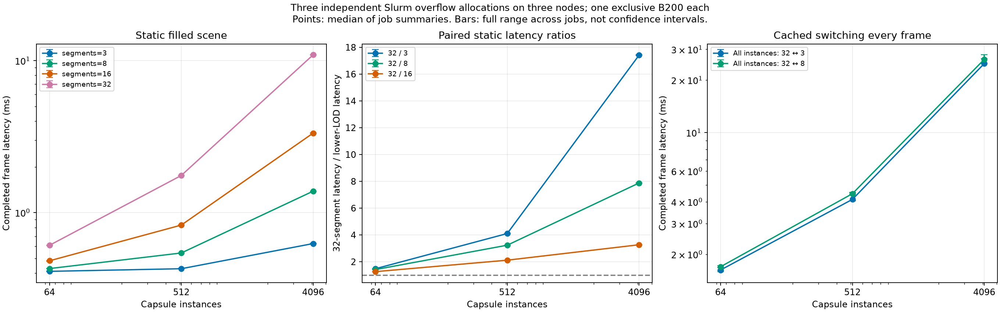
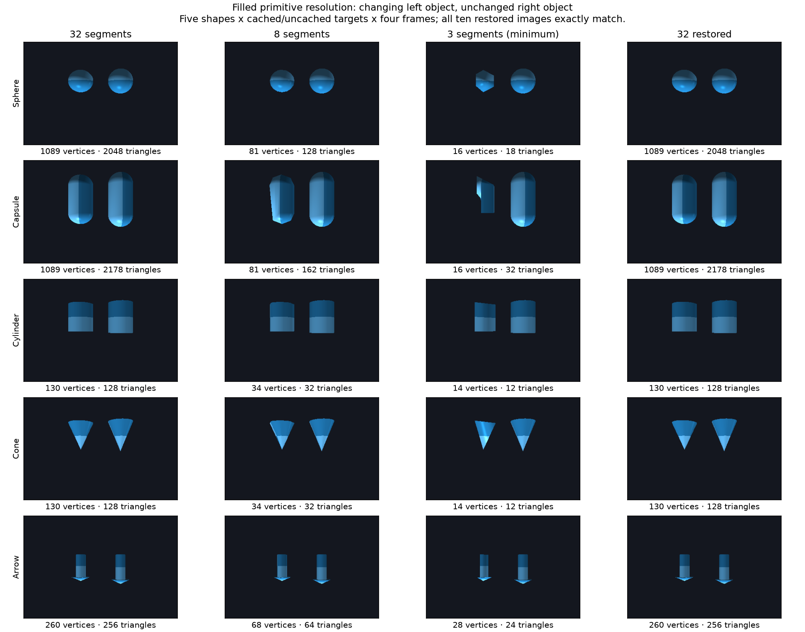
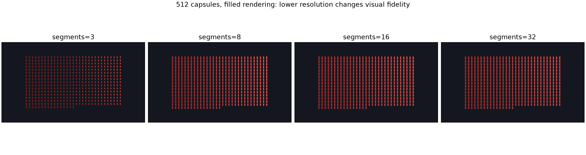

# OpenGL primitive resolution: validation at `cb86abb7`

This contribution exposes `segments` for spheres, capsules, cylinders, cones and arrows and supports changing an existing named primitive's resolution. The measured feature source is **`cb86abb75d123876d80c6832d8d360f4cda0cc10`**, based on official main **`0382a97e2c72911c1f6bba45274e12833a19d8e2`**. It includes four changed files and no CPU/OpenGL buffer fix. The exact signed-off source commit is recoverable from the [Git bundle](source.bundle); see [reproduction instructions](REPRODUCE.md).

The primary results are three independent Slurm `overflow` allocations, each with one full B200 GPU, on three distinct nodes. Nodes and their other GPUs may be shared. The scheduler records are anonymized as node groups A/B/C.

| Job | Node group | Case-order seed | State | Exit code | Elapsed |
|---|---|---:|---|---|---|
| 1144767 | A | 1121 | COMPLETED | 0:0 | 52 s |
| 1144768 | B | 1132 | COMPLETED | 0:0 | 85 s |
| 1144769 | C | 1143 | COMPLETED | 0:0 | 49 s |

These runs contribute **120 filled frames, 30 exact restored images, 6,840 timed frames and 270 blocks**. They exclude all earlier allocations and shared-GPU runs. CUDA/EGL identity, one visible CUDA device, MIG disabled, no preexisting GPU process and native interop with copy fallback disabled were checked separately for each allocation. Source, native-library hashes, benchmark script, versions and thread settings match across the three runs; the random order seeds differ.

[Data tables](TABLES.md) · [Full-precision CSV](overflow/independent-summary/across_jobs.csv) · [Per-job CSV](overflow/independent-summary/per_job_summary.csv) · [Independent-run report](overflow/independent-summary/REPORT.txt) · [Recomputation checks](recomputation.json)

## Correctness and visual fidelity

Each allocation renders five primitive types through `32 → 8 → 3 → 32`, both with previously cached target meshes and with first-time mesh creation. Pixel reads, nonempty changing and unchanged objects, instance identity, memberships, parent, scale, custom ID, mapped transforms, valid mesh data and GL errors are checked. All ten restored images per allocation match their initial images exactly.

Minimum resolution 3 is legal, but it visibly changes geometry and shading. Lower-resolution timings do not claim equal image quality.

## Timing method and limits

The benchmark draws filled polygons at 1280x720 with vsync, grid, sky, axes and overlays disabled. Capsule size shrinks as instance count increases to keep a fixed scene extent. Meshes are cached before timing. Each allocation runs five randomized repeats, with eight warmup frames per block and 32 measured static frames or 12 measured alternating-resolution frames. Every measured frame waits for `glFinish()`; creation, initial upload, warmup, pixel readback and query-result retrieval are excluded.

A job summary is the median of its five block medians. The published cross-job value is the median of three job summaries, with the full job minimum/maximum. Error bars are observed ranges, not confidence intervals. There are three allocations, not 6,840 independent statistical samples. All raw timing rows, including slow samples, remain available.

The all-instance switching experiment includes every `render_capsule()` call and instance-buffer rebuilding/upload work. Its larger latency is retained: at 4096 capsules, alternating 32/8 costs 26.271 ms/frame, with job summaries from 25.049 to 27.905 ms/frame. Cached geometry does not eliminate switching costs. No clocks or power limits were changed. CPU/node activity, GPU variation and thermal state can affect observations. Frame-latency reciprocals are not application or display FPS.

## Separate historical records

| Directory | Source | Results and interpretation |
|---|---|---|
| [Original acceptance](original/validation.txt) | `cb86abb7`; pre-commit checks identify matching file hashes | 14 context-free renderer tests, 30 wireframe CUDA/OpenGL frames, exact restored images, strict HTML documentation and formatting; baseline missing-keyword failures and the first harness error are retained. |
| [Shared-GPU supplement](shared-gpu/REPORT.txt) | `cb86abb7` | 40 filled correctness frames and 2280 timed frames; separate smoke output is excluded from totals. |
| [First exclusive allocation](overflow/jobs/1143896/REPORT.txt) | `cb86abb7` | 40 filled frames and 2280 timed frames; job 1143896, exit 0:0. |
| [Device-selection attempts](overflow/ATTEMPTS.txt) | unchanged feature source | Jobs 1143879 and 1143894 failed before rendering/timing. Their diagnostic logs are retained, with no measured frames counted. |

Older CPU/feature combined validation mentioned in retained reports belongs to a different combined source and is not part of the new totals. CPU buffer behavior is tracked separately in [issue #2120](https://github.com/NVIDIA/warp/issues/2120) and [draft PR #2121](https://github.com/NVIDIA/warp/pull/2121).

## Provenance and publication

Existing independent standard-build artifacts were reused without a new native build. Library and source hashes, command records, private-cache use and clean tracked source are recorded in the run directories. [The verification tool](verify_results.py) recomputes statistics directly from raw timing rows and checks exact restored PNG pixels without running Warp or GPU kernels.

Statements such as “local only” and “no public claim comment” inside retained reports describe their collection-time snapshots. This publication adds assets and a proposed PR body; no feature PR is opened. The independent-investigation [coordination request on #1110](https://github.com/NVIDIA/warp/issues/1110#issuecomment-6297170911) has no maintainer reply at publication. No assignment, approval or downstream production use is claimed.

Raw `private-slurm` output is excluded. Private filesystem paths and machine identifiers are redacted; public noreply attribution and DCO are retained. [Sanitization metadata](SANITIZATION.json) records any changed archived files, and [SHA256SUMS](SHA256SUMS) covers the published files. Unchanged historical checksum files remain useful; changed bundles receive a fresh checksum manifest with the original manifest archived separately.
