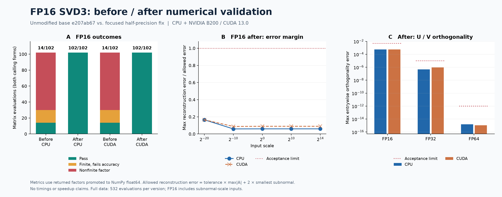

<!--
SPDX-FileCopyrightText: Copyright (c) 2026 NVIDIA CORPORATION & AFFILIATES. All rights reserved.
SPDX-License-Identifier: Apache-2.0
-->

# FP16 SVD3 forward validation — #2055

Base: `e207ab67b91bd843e3bda7918963fdaf83f17026`
Fix: `7bee3dbc`
Devices: x86_64 CPU and NVIDIA B200 with CUDA Toolkit 13.0.

| Backend | FP16 failures before | FP16 failures after | FP32 / FP64 |
|---|---:|---:|---|
| CPU | 88 / 102 | 0 / 102 | All pass; measured results unchanged |
| CUDA | 88 / 102 | 0 / 102 | All pass; measured results unchanged |

Counts include both calling forms. All 532 evaluations pass after the fix. These are numerical checks, not performance measurements.

- [Full report and error definitions](REPORT.txt)
- [Summary CSV](summary.csv) · [Before CSV](before.csv) · [After CSV](after.csv)
- [PNG figure](svd3-validation.png) · [SVG figure](svd3-validation.svg)
- [Measurement script](measure.py) · [Plot script](plot.py)
- [Checksums](SHA256SUMS) · [Privacy check](privacy-check.txt)
